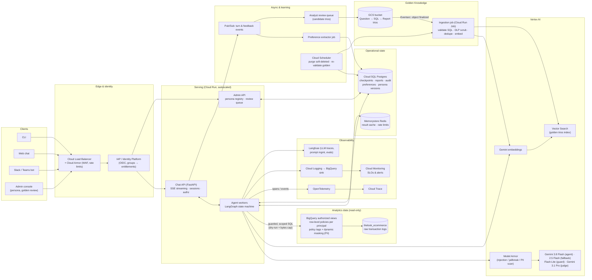
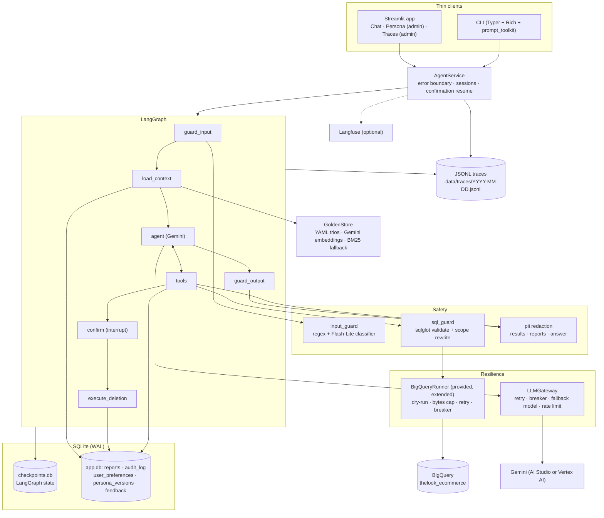
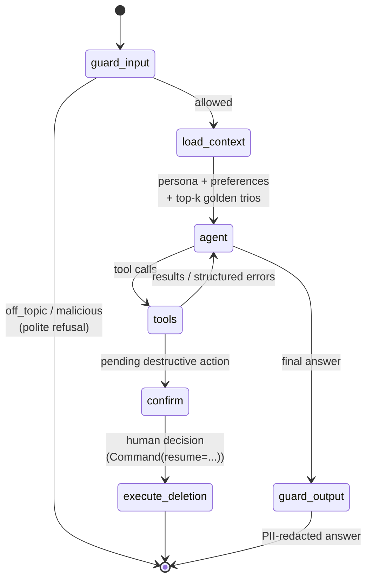
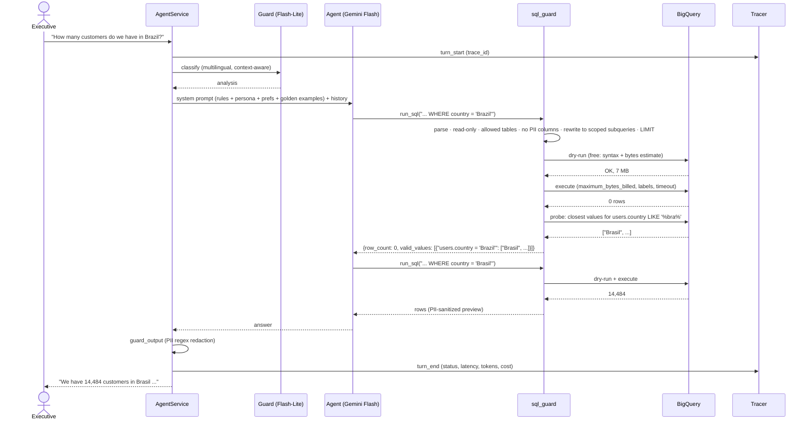
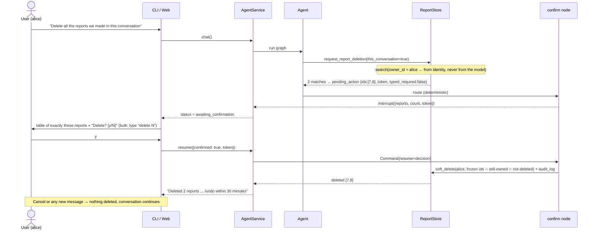
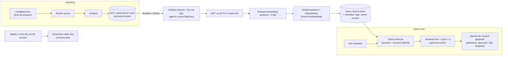
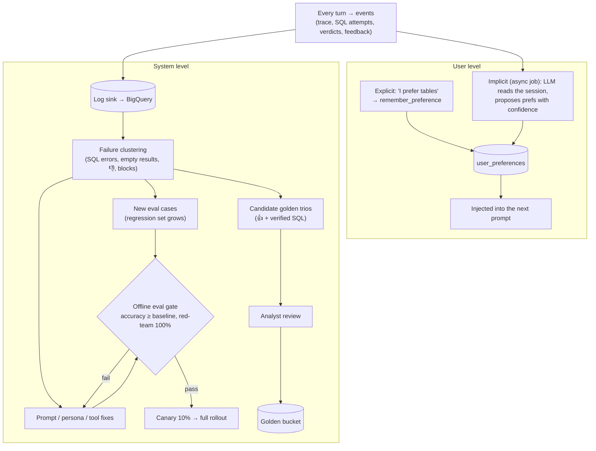

# Architecture

This document holds all diagrams. The reasoning behind each choice is in
[technical-design.md](technical-design.md).

1. [Production high-level design](#1-production-high-level-design-gcp)
2. [Prototype components](#2-prototype-components-this-repository)
3. [Agent state graph](#3-agent-state-graph-langgraph)
4. [Analytical question with self-correction](#4-sequence-analytical-question-with-self-correction)
5. [Destructive action with human confirmation](#5-sequence-delete-reports-with-human-confirmation)
6. [Golden Knowledge pipeline](#6-golden-knowledge-ingestion-and-retrieval)
7. [Learning loop](#7-learning-loop)

---

## 1. Production high-level design (GCP)

Notes:
- **Two hard trust boundaries** sit outside the LLM:
  - IAP/OIDC establishes *who* the user is.
  - BigQuery authorized views and row-level policies establish *what* data that identity can reach.

  The LLM can be fooled, but these two boundaries do not depend on it.
- **Agent workers are stateless.** All conversation state lives in Postgres (LangGraph checkpointer), so Cloud Run can scale to zero and a human-in-the-loop interrupt can be resumed on any instance.
- **Secrets** (Langfuse keys, Slack tokens) live in Secret Manager. The service accounts are:
  - *agent*: BigQuery Job User plus Data Viewer on the authorized views only;
  - *ingestion*: Storage Object Viewer, DLP User.

## 2. Prototype components (this repository)

## 3. Agent state graph (LangGraph)

Budgets that bound every turn:
- `max_sql_queries` (8 queries) and `max_sql_errors` (3 failed or empty queries), counted separately;
- `max_tool_calls` (14);
- `turn_token_budget` (250k tokens);
- LangGraph `recursion_limit`.

When the budget is exhausted, the agent is forced to answer with what it has, without tools.

## 4. Sequence: analytical question with self-correction

## 5. Sequence: delete reports with human confirmation

## 6. Golden Knowledge ingestion and retrieval

## 7. Learning loop

